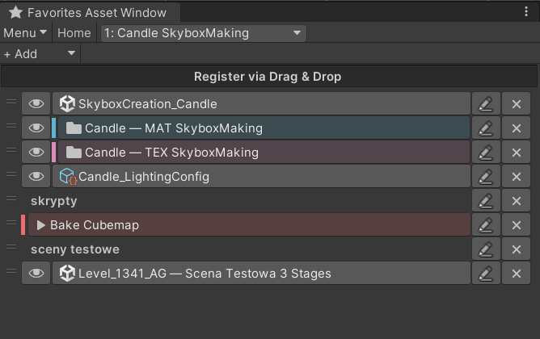

# Favorites Asset Window — PATATAJEC fork

A customized fork of [Favorites Asset Window by MasyoLab](https://github.com/MasyoLab/UnityTools-FavoritesAsset), with bookmark notes, colors, menu command shortcuts, and editable section spacers.

**Current fork version: 1.8.1.** The changes in this fork were checked in **Unity 2022.3.62f2**, with **39 passing EditMode tests**, including menu validation and a separator GUI rendering test. The broader compatibility matrix in the original documentation below belongs to the upstream plugin.

## Preview of version 1.8.0



## Changes in this fork

- **Bookmark notes:** add a custom suffix after the original asset or folder name, for example `Candle — MAT SkyboxMaking`. This does not rename the asset or folder.
- **Colors:** choose a quick palette color or a custom color for each bookmark. A side accent and a subtle background tint make related entries easier to recognize.
- **Pencil editor:** the pencil next to **×** edits the bookmark settings. **Save** applies changes, **Cancel** discards them, and **Reset → Save** restores the default appearance.
- **Menu command bookmarks:** use **+ Add → Menu command...** to enter an exact Unity menu path. The entry runs the command when clicked and supports notes and colors. Saving a bookmark does not execute it. See the [Console shortcut example](#example-add-a-console-shortcut) below.
- **Menu execution update (1.8.1):** command bookmarks now let Unity validate and execute the command in one operation, without a separate `Menu.GetEnabled` pre-check. This removes a possible early rejection before execution. Tests cover commands under both **Tools** and **Assets**, changing validation states, and execution exactly once with the current selection. The reported intermittent issue in the user's full project still needs confirmation after updating.
- **Section spacers:** use **+ Add → Separator** for a movable blank row. There is no horizontal rule, and selection highlights only the side edges. Its pencil editor lets you add an optional section caption and color.
- **Independent group copies:** copied bookmarks retain their appearance and can be edited without changing the source group.
- **Persistent settings:** notes, colors, commands, spacers, and their order are saved with groups and included in import/export. Existing asset bookmarks remain compatible. Hover over an asset bookmark to see its full project path.

## Installation

1. Install Git and make sure Unity can find it. Restart Unity after installing Git if necessary.
2. Open your Unity project and select **Window → Package Manager**.
3. Click **+ → Add package from git URL...**.
4. Paste the following URL and click **Add**:

```text
https://github.com/PATATAJEC/UnityTools-FavoritesAsset.git?path=Assets/MasyoLab/FavoritesAsset
```

5. Open **Tools → Favorites Asset Window**.

This installs the current plugin from this fork's `master` branch. If you already installed the original MasyoLab package, replace it with this fork; both use the same package name.

Your personal bookmarks are not included when someone installs the plugin. To share a bookmark collection, use **Menu → Export**, send the exported file, and load it with **Menu → Import** in the receiving project. Asset references require the corresponding assets and their GUIDs to exist there.

## Menu command behavior

Enter the menu hierarchy using `/` separators, preserving spelling and case. Commands use the current selection in Unity and may require a particular editor state or an installed third-party tool.

### Example: add a Console shortcut

Unity's Console is available under **Window → General → Console** ([Unity documentation](https://docs.unity3d.com/2022.3/Documentation/Manual/Console.html)). To add it to your favorites:

1. Open **Tools → Favorites Asset Window** and select the group where you want the shortcut.
2. Click **+ Add → Menu command...**.
3. In **Menu path**, enter `Window/General/Console`.
4. Optionally enter `Debugging` in **Name suffix** and enable **Color code** to choose a color.
5. Click **Save**. The bookmark appears as **Console** or **Console — Debugging** if you added that suffix. Saving only creates the bookmark.
6. Click the bookmark to open or focus the Console. Use its pencil button to change the path, suffix, or color later.

The same pattern applies to your own tools. For example, **if your project already has** a command under **Tools → My Tools → Bake Cubemap**, its bookmark path is:

```text
Tools/My Tools/Bake Cubemap
```

Use the menu labels separated by `/`, without keyboard shortcut labels. You do not need to find the script that implements the command or enter a `.cs` file path. The command must already exist in the current Unity project.

**Known limitation in 1.8.0:** `Assets/Show in Explorer` has been reported not to work from a bookmark in the user's setup. Dedicated handling for that command has not been added. A menu path being available does not by itself confirm that every built-in or context-dependent command will work from this window.

---

## Original plugin documentation — MasyoLab

> Everything below this notice is the original plugin's documentation, retained for reference and attribution. Its installation URLs, screenshots, badges, support statements, and release links refer to **MasyoLab's upstream plugin**. To install **this modified fork**, use the PATATAJEC installation instructions above.

# Favorites Asset Window

[](https://github.com/MasyoLab/UnityTools-FavoritesAsset/blob/master/LICENSE.md)
[](https://github.com/MasyoLab/UnityTools-FavoritesAsset/actions/workflows/unity-test.yml)
[](https://unity.com/releases/editor/archive)

[](https://app.fossa.com/projects/git%2Bgithub.com%2FMasyoLab%2FUnityTools-FavoritesAsset?ref=badge_shield)

| English | [日本語](README_ja.md) |
| :------: | :---- |

## Overview

This function allows you to bookmark (register as a favorite) resources.


## Install

### PackageManager


In the package manager, press “Add package from git URL...” and paste the following string into the input field that comes up.

```text
https://github.com/MasyoLab/UnityTools-FavoritesAsset.git?path=Assets/MasyoLab/FavoritesAsset
```

### UnityPackage

It is available from [Releases](https://github.com/MasyoLab/UnityTools-FavoritesAsset/releases).

### Usage


The extended editor can be used from “Tools”.

Note : The access method may change with future expansion.

### Add to Favorites

You can bookmark assets by dragging and dropping them.


### Ping asset. Open asset

Registered assets can have a focus button for the Project view and an open button for the asset.


### Unlock favorites


### Sort Favorites


### Add a favorite group


### Sorting favorite groups


### Deleting a favorite group

When you delete a bookmark, the contents of the bookmark are also deleted.


### menu


The following data is included in the import/export target.

- Favorite Data
- Favorite Groups
- Last Favorite Group Opened

## Supported Unity Versions

This editor extension has been tested on the following Unity LTS versions:

- ✅ Unity 6000.3 LTS
- ✅ Unity 6000.0 LTS
- ✅ Unity 2022.3 LTS
- ✅ Unity 2021.3 LTS
- ✅ Unity 2020.3 LTS
- ✅ Unity 2019.4 LTS

> Automated tests run on all versions when a Pull Request is created via CI/CD. For details, see the [CI/CD Setup Guide](.github/CI_SETUP.md).

## Other

This extension is a tool I created as a hobby.

Regarding feature additions, I will work on them if I have good ideas and motivation.  
If you have any ideas, pull requests for feature extensions are very welcome.

Regarding bug fixes that have been reported, I will fix them as quickly as 1 week, or as late as 3 weeks.

## License

This extension editor is licensed under the MIT License. Please see [LICENSE](https://github.com/MasyoLab/UnityTools-FavoritesAsset/blob/master/LICENSE.md) for more information.
